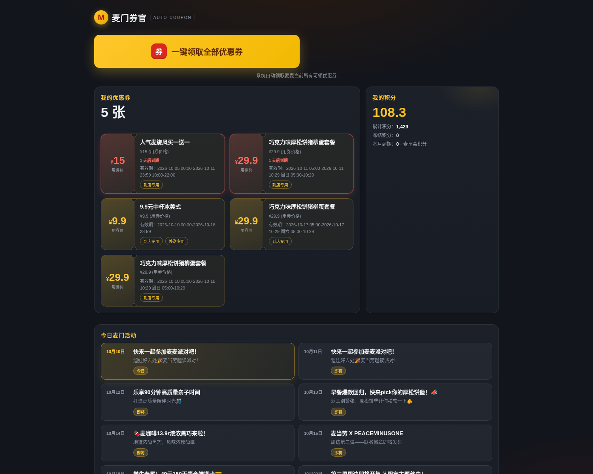

<div align="center">

# 麦门券官 · MCD Auto-Coupon

**一键领光麦当劳优惠券，省钱成绩单看得见**

基于麦当劳中国 MCP 真实券/积分/活动数据 · 领完即走的自动化小工具

   

</div>

---

## 🚀 在线体验

点开即玩，无需安装任何环境（真实麦当劳 MCP 数据实时运行）：

<p align="center">
  <a href="https://tndsprxmfjfg.cloud.sealos.io">
    
  </a>
</p>

> 在线版已配置麦当劳 MCP 真实 Token（仅存于云端环境变量，代码零泄漏）。想自己跑一遍完整流程，见下方「快速开始」。

---

## 产品截图

<p align="center">
  
</p>

<p align="center">
  
</p>

*上：桌面看板 · 下：移动端（图中为真实 MCP 数据运行效果：券面化卡片、到期倒计时警示、今日活动高亮）*

---

## 这是什么？

麦门券官是一款**领完即走的自动化券管家** Web 应用：打开页面，点一下「一键领取」，系统自动把麦麦省当前所有可领的优惠券全部领到手，并为你生成一张「券资产 + 积分 + 今日活动」的省钱看板。

- **一键领光**：调用麦当劳 MCP 的 `available-coupons`（查可领券）→ `auto-bind-coupons`（一键领取）→ `query-my-coupons`（领后核对），全流程自动化；
- **券面化资产卡**：每张券以"券面"呈现——大金额、撕边圆孔、标签徽章，快过期券红色警示并自动置顶，已过期券置灰；
- **积分概览**：可用积分金色高亮，本月到期积分红色预警（来自 MCP `query-my-account`）；
- **今日麦门活动**：活动日历雷达（`campaign-calendar`），今日金色高亮、即将/往期自动分组排序；
- **省钱成绩单**：对明确标出「立减/省 X 元」的券自动汇总"预计可省"，没有明示金额的券**不虚报**；
- **无 Token 演示模式**：未配置 Token 自动使用内置模拟数据，clone 即可完整体验；
- **零依赖**：仅用 Node.js 内置能力，`node server.js` 直接运行。

一句话：**别人的券在钱包里吃灰，你的券被麦门券官安排得明明白白。**

## 功能特性

| 功能 | 说明 |
|---|---|
| 一键领券 | 自动完成 查券 → 领券 → 核对 三步，一次点击领光全部可领券 |
| 券面化资产卡 | 大金额券面 + 撕边设计 + 标签徽章；到期倒计时警示（≤3 天红色置顶）/ 过期置灰 |
| 积分概览 | 可用/累计/冻结/本月到期；本月到期积分红色预警 |
| 活动日历雷达 | 今日金色高亮 · 即将/往期自动分组，领券前先看活动 |
| 省钱成绩单 | 只统计明示「立减/省 X 元」的券，诚实不虚报 |
| 桌面响应式 | 桌面三栏看板 + 券列表双列；移动端单列流畅 |
| 演示模式 | 无 Token 自动降级为内置模拟数据，可完整跑通全流程 |

## 快速开始

### 环境要求

- Node.js **18 或更高版本**（内置 `fetch`，零第三方依赖，无需 `npm install`）

### 1. 克隆并启动（演示模式）

```bash
git clone https://github.com/odin1024/mcd-auto-coupon.git
cd mcd-auto-coupon
node server.js
```

打开浏览器访问 `http://localhost:3001`，点击「一键领取全部优惠券」即可完整体验领券全流程（此时使用内置模拟数据，界面会显示"演示模式"徽标）。

### 2. 接入真实麦当劳 MCP

从 [麦当劳 MCP 官方平台](https://open.mcd.cn/mcp) 登录并激活申请 MCP Token（此 Token 代表您的麦当劳会员身份，请严格保管）。

```bash
export MCD_MCP_TOKEN=你的Token
node server.js
```

服务启动日志会显示 `REAL（真实麦当劳 MCP）` 模式。此时券列表、领券、积分、活动均来自麦当劳官方实时接口。

> 安全提醒：请通过环境变量传入 Token，**切勿**把 Token 写入代码、配置示例或提交到仓库。

## 使用示例

启动后打开页面：

```text
┌─────────────────────────────────────────────────┐
│  🍟 麦门券官                          [演示模式] │
│                                                 │
│  ┌───────────────────────────────────────────┐ │
│  │  [ 一键领取全部优惠券 ]                    │ │
│  └───────────────────────────────────────────┘ │
│  ── 领券结果：共 2 张 · 成功 2 · 失败 0 ──     │
│  ✓ 9.9元薯你最甜                               │
│  ✓ 任意消费立减3元                             │
│  ── 我的优惠券：3 张 ──                        │
│  9.9元薯你最甜  ¥9.9 (用券价格)               │
│  任意消费立减3元  立减3元                      │
│  ✅ 已领券预计可省约 ¥3                        │
│  ── 我的积分：7,592 ──                         │
│  累计 141,760.94 · 冻结 30 · 本月到期 0        │
│  ── 今日麦门活动 ──                            │
│  10月10日 · 今日 · 麦麦会员日：今日积分双倍到账 │
└─────────────────────────────────────────────────┘
```

## 真实使用麦当劳 MCP

| MCP 工具 | 用途 | 在本项目中的作用 |
|---|---|---|
| `available-coupons` | 查询麦麦省可领优惠券列表 | 领券前扫描"可领 / 已领 / 不可领"状态 |
| `auto-bind-coupons` | 一键领取全部可领优惠券 | 核心写操作，领取后返回 couponId/couponCode |
| `query-my-coupons` | 查询我的优惠券 | 领券前后两次核对，展示券资产看板 |
| `query-my-account` | 查询我的积分账户 | 积分概览（可用/累计/冻结/到期） |
| `campaign-calendar` | 查询当月活动日历 | 今日活动雷达 |

完整的接入地址、协议、调用流程与安全边界见 [MCP_INTEGRATION.md](./MCP_INTEGRATION.md)。

## 目标用户

- 麦当劳高频顾客：每天点餐前想先把券领光、顺带看看今天有什么活动；
- 怕麻烦的用户：不想一个个手动领券，点一下就全部领完；
- 积分爱好者：想随时知道可用积分和即将到期的积分；
- 对"AI 应用真实调用品牌 MCP 写操作"感兴趣的开发者。

## 测试

```bash
node --test test/*.test.js
```

覆盖：三种官方 Markdown 文本形态解析（券列表/领券结果/我的券）、活动日历解析、省钱估算口径、看板聚合与 mock 客户端联通。当前 **14/14 全部通过**。

## 项目结构

```text
.
├── CONTEST_DECLARATION.md   # 官方参赛声明（内容不可修改）
├── MCP_INTEGRATION.md       # 麦当劳 MCP 集成说明
├── mcp-config.example.json  # 脱敏 MCP 配置示例（仅环境变量占位符）
├── docs/                    # README 配图（真实 MCP 数据运行截图）
├── examples/
│   └── mock-data.json       # 无 Token 演示用模拟数据（严格贴近官方格式）
├── public/                  # 前端仪表盘（零外部依赖）
├── src/
│   ├── mcp-client.js        # 零依赖 MCP Streamable HTTP 客户端
│   └── coupon-engine.js     # 券/积分/活动解析引擎 + 领券流程 + 省钱统计
├── test/                    # 自动化测试（node --test）
└── server.js                # HTTP 服务入口
```

## 安全边界

- 不在仓库、配置示例、命令脚本中保存任何真实 Token、手机号、地址等个人信息；
- 未配置 Token 时自动进入演示模式，不会发起任何外网请求；
- 本项目仅使用麦当劳 MCP 的**领券类能力**（available-coupons / auto-bind-coupons / query-my-coupons / query-my-account / campaign-calendar），不涉及下单、支付；
- 省钱金额只统计明确标注「立减/省 X 元」的券，用券价等其他表述**不计入**，避免误导；
- 优惠券、价格、活动以麦当劳官方渠道的实时结果为准。

## 📮 反馈与联系

用起来有想法、遇到问题，或想要更多麦门玩法？欢迎扫码关注公众号 **知白守黑** 私信我，每条反馈都会认真看 👇

<p align="center">
  
</p>

## License

[MIT](./LICENSE)

---

本项目是 **麦当劳程序员创意开发大赛** 参赛作品，由参赛者独立开发，**非麦当劳官方产品**。
